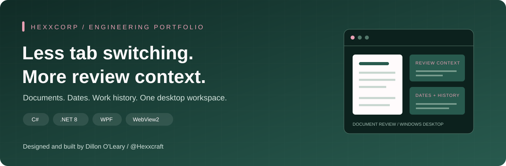
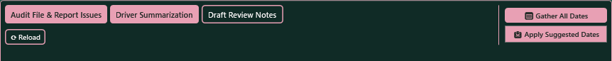
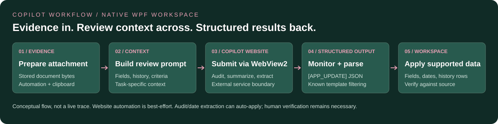
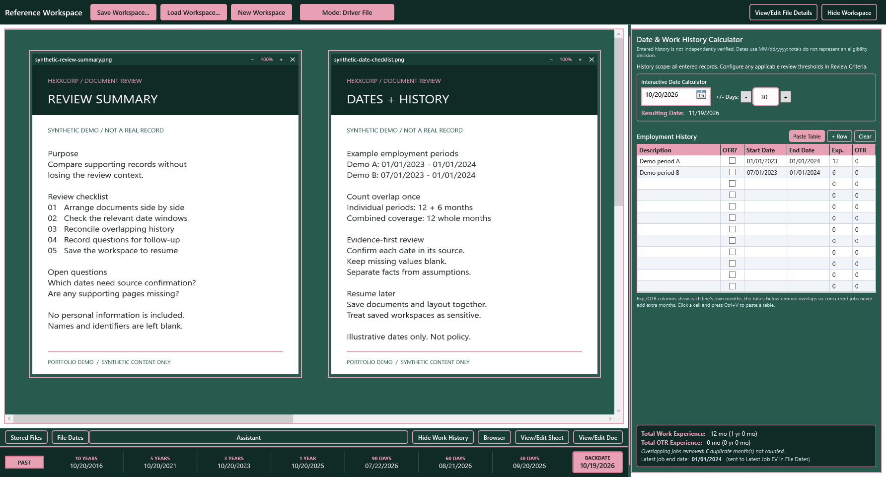

<p align="center">
  
</p>

<p align="center">
  <a href="https://github.com/Hexxcraft/document-review-tool/actions/workflows/build.yml"></a>
  
  
  
</p>

# Hexxcorp Document Review Utility

**A C#/.NET desktop workspace that connects document review with Microsoft Copilot: prepare context, attach evidence, and bring structured results back into the app.**

Designed and built by **[Dillon O'Leary (@Hexxcraft)](https://github.com/Hexxcraft)**.
A C#/.NET engineering portfolio project centered on a practical workflow problem:
keeping evidence, review context, and assistant-assisted data entry in one workflow.

[Copilot workflow](#copilot-integration-more-than-a-chat-panel) · [See the app](#see-the-app) · [Run locally](#run-locally) · [Try the demo](docs/DEMO.md) · [Engineering walkthrough](docs/ARCHITECTURE.md)

### At a glance

- **Desktop engineering:** a persistent PDF/image canvas, shared date/history tools,
  and optional native Word/Excel integration.
- **Copilot workflow integration:** document-attachment automation, context-aware
  prompt submission, response monitoring, and structured field updates.
- **Practical delivery:** synthetic demo assets, a source-level engineering
  walkthrough, and a verified Windows CI build.

## The problem

Reviewing a document packet is not just reading a PDF. It means comparing records,
checking dates, reconciling work history, taking notes, and returning to unfinished
work without losing context. Spread across separate windows, those tasks become a
constant exercise in switching tabs and re-entering information.

**This project turns that scattered workflow into a persistent desktop workspace.**
Its starting use case is driver-file and equipment-document review, with editable
criteria for additional review requirements.

| Workflow friction | What I built |
| --- | --- |
| Comparing documents in separate viewers | A movable, resizable canvas for PDFs and images, with per-document zoom |
| Losing layout and context between sessions | Self-contained `.lqw` workspaces storing documents, layout, notes, dates, and history |
| Repeating date calculations | A shared date calculator, rolling date references, and visual date-field checks |
| Double-counting overlapping work history | Employment-history calculations that merge overlapping intervals before totaling months |
| Switching tools to work on supporting files | Optional embedded Word and Excel drawers, with pop-out windows |
| Copying evidence and results between the app and chat | Copilot attachment/prompt automation and structured results mapped back into workspace fields |

These are implemented capabilities, not measured productivity or accuracy claims.

## Copilot integration: more than a chat panel

**The engineering work is the round trip between a desktop review session and
Copilot, not just embedding a website.**



*Actual WPF Assistant toolbar, not a live conversation or a claimed successful
response. No account, chat history, or personal records were used for the capture.*



| Stage | What the application does |
| --- | --- |
| **1. Prepare evidence** | Resolves a stored document and attempts to attach it through browser automation, with clipboard support for manual attachment |
| **2. Assemble context** | Builds task-specific prompts from current fields, dates, conflicts, work history, file names, review mode, and editable criteria |
| **3. Run the review task** | Attempts to insert and submit the prompt to the embedded Copilot website for audits, summaries, review notes, or date extraction |
| **4. Read structured output** | Monitors responses after audit/date-extraction actions and parses supported `[APP_UPDATE]` JSON blocks, filtering known template echoes |
| **5. Update the workspace** | Applies supported identifying fields, dates, and employment-history rows; a manual apply action can also read the response or clipboard |

**Why it matters:** it connects review context and structured data entry instead
of leaving the reviewer to reconstruct a prompt and manually retype every result.
Audit and date-extraction actions can **automatically apply** detected updates;
the reviewer must verify them against source documents.

**Integration boundary:** this is the **public Microsoft Copilot website hosted
in WebView2 inside a native WPF application**. It does not control the installed
Windows Copilot app, use a Copilot/model SDK, or bundle an API key. Automation
depends on the website UI, available account features, and sign-in state; attachment
and submission are not guaranteed. Confirm the intended files are attached before
relying on a review. Native Word/Excel integration is separate and uses COM/Win32.

[Trace the implementation](docs/ARCHITECTURE.md#5-connect-the-copilot-round-trip) ·
[Try the optional synthetic-data walkthrough](docs/DEMO.md#optional-copilot-round-trip)

## See the app



*Actual WPF interface with synthetic demonstration documents. No real driver,
employer, customer, or qualification records are included.*

<details>
<summary><strong>Feature tour</strong></summary>

- **Document canvas:** import PDF, PNG, JPG, or JPEG files; move, resize, zoom,
  hide, and restore individual documents.
- **Persistent review sessions:** save and reload embedded document contents and
  workspace state; 30-minute autosaves retain up to 20 backups.
- **Three review modes:** Driver File, Full Unit, and Post-Review Audit. Audit mode
  uses the configured qualified date as the evaluation date for relevant checks.
- **Shared dates and history:** synchronize tracker data across the dashboard and
  workspace, with overlap-aware employment totals.
- **Editable criteria:** maintain organization, industry, and review-specific
  requirements through the in-app editor.
- **Supporting tools:** Word and Excel drawers, a tabbed WebView2 browser, and an
  assistant drawer using the public Microsoft Copilot website.
- **Structured assistant responses:** parse supported `[APP_UPDATE]` JSON fields
  back into workspace data, including dates and employment-history rows.

</details>

## For recruiters and engineers

**A quick review path:** look at the screenshot, try the [five-minute demo](docs/DEMO.md),
then follow the [architecture walkthrough](docs/ARCHITECTURE.md).

| Engineering area | Evidence in the source |
| --- | --- |
| Stateful desktop UI | [Canvas models](Models/CanvasItemModel.cs), WPF bindings, reusable controls, docked and pop-out windows |
| Persistence and recovery | [Workspace serialization](Services/WorkspaceFileService.cs), versioned models, embedded file bytes, bounded autosave rotation |
| Date and interval logic | [Tracker model](Models/TrackerModel.cs), date normalization, interval merging, shared state |
| Native application integration | [Word controller](Services/EmbeddedWordController.cs), [Excel controller](Services/EmbeddedExcelController.cs), and Win32 window hosting |
| Copilot workflow orchestration | [Attachment, prompt submission, response monitoring, and field updates](Windows/WorkspaceWindow.xaml.cs), plus [context building and structured parsing](Services/CopilotContextBuilder.cs) |
| Delivery | Windows build workflow, reproducible build commands, a built-in verification mode, and synthetic demo assets |

The implementation uses **WPF code-behind for interaction-heavy workspace behavior**
and **view models for shared observable state**; it is not presented as a pure-MVVM
application. See the [trade-offs and limitations](docs/ARCHITECTURE.md#trade-offs-and-next-steps)
for an honest discussion of the current design.

## Run locally

### Prerequisites

- Windows and the **.NET 8 SDK**. This is a WPF application, not a cross-platform app.
- **Microsoft Edge WebView2 Runtime** for browser and assistant features:
  [official download](https://developer.microsoft.com/microsoft-edge/webview2/).
- **Desktop Microsoft Word and/or Excel** only if using their respective embedded
  editors. These integrations use locally installed Office through COM; Office is
  not bundled.
- Internet access for package restore and external web/assistant features. Local
  canvas, date, history, and workspace features do not require an assistant account.

```powershell
git clone https://github.com/Hexxcraft/document-review-tool.git
Set-Location document-review-tool
dotnet restore .\HexxcorpDocumentReviewUtility.csproj
dotnet build .\HexxcorpDocumentReviewUtility.csproj --configuration Release --no-restore
dotnet run --project .\HexxcorpDocumentReviewUtility.csproj --configuration Release --no-build
```

Use a user-writable project/output directory: configuration, review criteria, and
workspace backups are written beside the executable.

### Build a self-contained Windows x64 folder

```powershell
dotnet publish .\HexxcorpDocumentReviewUtility.csproj `
  --configuration Release --runtime win-x64 --self-contained true `
  --output .\artifacts\win-x64
```

Run `HexxcorpDocumentReviewUtility.exe` in the output folder. Keep the published
files together. Self-contained publishing bundles .NET, **not** WebView2 Runtime
or Microsoft Office. Build outputs and local data are excluded from version control.

### Verification

The GitHub Actions workflow restores and builds the application on Windows.
The app also includes interactive verification checks for drawer behavior,
workspace schema, prompt construction, response parsing, history calculations,
and WebView2 initialization:

```powershell
& .\bin\Release\net8.0-windows\HexxcorpDocumentReviewUtility.exe --verify
Get-Content .\verify_results.txt
```

Run verification from a writable directory in an interactive Windows session.
It may open windows and exercise Office if Excel is installed; WebView2 Runtime
is required. Exit code `0` means success; `1` means a check failed. The detailed
report is written to `verify_results.txt` in the working directory.
This is a smoke/integration harness, not a comprehensive unit-test suite.

## Privacy and responsible use

- **No API key is required or bundled.** The assistant opens the public Copilot
  website; it is not a direct model API integration. Authentication and service
  availability are controlled by that website.
- **Local does not mean encrypted.** `.lqw` files are JSON with embedded document
  bytes, original paths, and any entered identifying information. Configuration,
  autosaves, temporary document copies, and browser profiles may also contain
  sensitive data. Protect them as you would the original records.
- **External services are a separate trust boundary.** Browser/assistant actions
  can transmit documents and context. SSN masking in prompt context does not
  anonymize attachments or other fields. Review sharing permissions and provider
  terms before using real records.
- **Human review remains necessary.** Assistant-suggested updates can populate
  fields. Confirm the source evidence, dates, and findings before relying on them.
- **Criteria are not a compliance certification.** The starter DOT reference is
  incomplete and not legal advice. User-editable criteria do not replace every
  built-in date/history rule; verify applicability before using another industry.
- **Public demos use synthetic data only.** Local configuration, customized
  criteria, workspaces, backups, Office files, and build outputs are ignored.

## Project map

```text
Controls/       Reusable canvas chrome, PDF rendering, and tracker UI
Models/         Workspace schema, document items, criteria, and history logic
Services/       Persistence, Office/Win32 integration, browser tabs, prompts
Themes/         Shared green-and-rose visual theme
ViewModels/     Shared observable dashboard/tracker state
Windows/        Workspace, criteria editor, and Office pop-out windows
docs/           Architecture, walkthrough, and synthetic visual assets
.github/        Windows build automation
```

## Author and usage

**Dillon O'Leary** · [GitHub: Hexxcraft](https://github.com/Hexxcraft)

Published as an engineering portfolio for technical review. No open-source
license is currently granted for the original application code.
Third-party packages and the WebView2 loader remain subject to their own terms;
see [third-party dependencies](docs/THIRD_PARTY.md).
