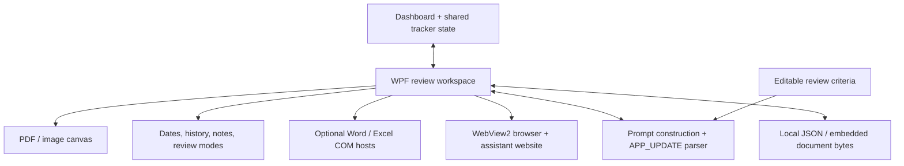

# Engineering walkthrough

## System at a glance

The diagram shows component relationships, not an automatic background upload
pipeline. External sharing happens through browser/assistant interactions.

## Follow one review session through the code

### 1. Import and arrange

[WorkspaceWindow](../Windows/WorkspaceWindow.xaml.cs) accepts supported files from
file dialogs and drag-and-drop. [CanvasItemModel](../Models/CanvasItemModel.cs)
keeps original bytes alongside the item's position, size, zoom, and visibility.
Observable properties drive the WPF canvas.

[PdfBoxControl](../Controls/PdfBoxControl.xaml.cs) renders PDF pages through
PDFtoImage/SkiaSharp on a background task, then displays the resulting bitmaps.
Images are decoded into WPF bitmap sources. Document zoom is independent of
the frame dimensions.

### 2. Keep review state consistent

[MainViewModel](../ViewModels/MainViewModel.cs) owns shared tracker state.
[TrackerModel](../Models/TrackerModel.cs) normalizes date input, manages employment
rows, and computes totals.

Employment periods are sorted and overlapping or adjacent intervals are merged
before counting whole months. That prevents overlapping jobs from inflating the
combined history total. Individual row totals are deliberately distinct from
the union total.

Review modes and audit-date context are coordinated with
[CopilotContextBuilder](../Services/CopilotContextBuilder.cs). The workspace also
contains built-in date checks; changing editable criteria is not a replacement
for changing those rules.

### 3. Save a portable workspace

[WorkspaceFileService](../Services/WorkspaceFileService.cs) maps live state to
[WorkspaceProjectFile](../Models/WorkspaceProjectFile.cs), currently schema version
13, and serializes it to JSON. Document and Office-file bytes are embedded, so
the workspace need not depend on the original files staying in place.

Defaults let older files omit newer fields, with original-path fallback for
older records that lack embedded bytes. This is additive compatibility, not a
complete migration framework or strict schema validation system.

Autosaves run every 30 minutes and retain at most 20 backups. Portability comes
with a cost: base64 and whole-file serialization increase workspace size and
memory use. Files are not encrypted.

### 4. Bring other tools into the workspace

[EmbeddedWordController](../Services/EmbeddedWordController.cs) and
[EmbeddedExcelController](../Services/EmbeddedExcelController.cs) automate local
Office applications through COM.
[Win32PanelHost](../Services/Win32PanelHost.cs) provides the native hosting surface.
This preserves native Office rendering/editing, but introduces Windows/Office
version, focus, window-management, and lifetime constraints.

[BrowserTabManager](../Services/BrowserTabManager.cs) manages WebView2 browser tabs.
The assistant drawer uses the public Copilot website rather than a model SDK or
an API key. Website UI changes and sign-in requirements can affect that workflow.

### 5. Connect the Copilot round trip

The integration coordinates native workspace state with a browser session rather
than calling a model API:

1. **Resolve and attach:** `AttachFileToCopilotAsync` in
   [WorkspaceWindow](../Windows/WorkspaceWindow.xaml.cs) materializes a stored file
   when needed, prepares Windows clipboard data, and attempts browser upload
   automation. Its fallback can leave the file ready for manual paste rather
   than prove upload completion.
2. **Build and submit:** action handlers construct task-specific context and call
   `SendPromptToCopilotAsync`. WebView2 script execution attempts composer
   insertion and send-button interaction; the prompt is also copied to the clipboard.
3. **Monitor and parse:** audit and date-extraction actions start
   `MonitorAndAutoApplyCopilotUpdatesAsync`, which polls for a structured response
   for a bounded period.
4. **Apply:** detected supported updates go through `ApplySuggestedFieldsAndDates`.
   A separate manual action can read browser output or the clipboard. Automatic
   application is not a human approval gate.

[CopilotContextBuilder](../Services/CopilotContextBuilder.cs) assembles review prompts
from current fields, file names, conflicts, tracker context, and editable criteria.
Supported assistant responses can contain an `[APP_UPDATE]` JSON block.

The parser scans newer blocks first, filters known prompt-template markers, and
extracts supported fields. This helps distinguish a final answer from an echoed
template; it does not guarantee that extracted facts are correct or establish a
security boundary against untrusted document instructions.

**Boundary and reliability:** this is the public Copilot website in WebView2,
not the installed Windows Copilot application or a Copilot/model SDK. Authentication,
upload availability, page structure, and model behavior belong to the external
service. A visible prompt or prepared clipboard is not evidence of a successful
attachment, completed review, or correct extraction. Confirm source evidence and
attachment state, and use only authorized data.

## Trade-offs and next steps

This is a desktop workflow application with a mix of view models, services, and
substantial code-behind. Native window hosting and canvas interaction are handled
close to the UI; shared date/history state and persistence have separate types.

Areas I would prioritize in a production hardening pass:

1. Extract built-in date rules and workspace orchestration into independently
   testable components; add focused unit and regression tests.
2. Add explicit schema validation, atomic file writes, and stronger recovery/error
   reporting around persistence.
3. Add deliberate confirmation and provenance for assistant-derived field updates.
4. Define a data-retention policy covering saved files, backups, temporary files,
   and browser profiles; evaluate encryption at rest.
5. Add resource limits and cancellation for large PDFs and embedded workspaces.
6. Reduce coupling to website DOM behavior and global/static context providers.

These are future directions, **not claims about implemented protections**.
